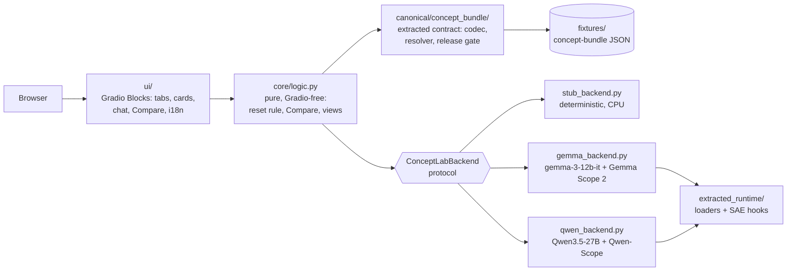

<p align="center">
  
</p>

<p align="center">
  
  <a href="LICENSE"></a>
</p>

# SAE Concept Lab

**SAE Concept Lab is a web app for "turning a dial" inside a language model.** You pick a concept the model represents internally, turn it up or switch it off, and chat with the model to see how its replies change. You can also run the same prompt with and without the change, side by side. It runs on any laptop with a built-in fake model, or on a GPU with real Gemma and Qwen models.

**In technical terms:** SAE Concept Lab is a Gradio 6 UI and a fail-closed release gate for single-feature interventions with sparse autoencoders (SAEs). It has two model tabs, `gemma-3-12b-it` + Gemma Scope 2 and `Qwen3.5-27B` + Qwen-Scope. Each tab is wired to a forward hook that clamps (amplify) or zeroes (suppress) one SAE feature at a fixed layer. Every control the UI offers, such as which concepts exist, which directions are allowed and what dose a strength resolves to, comes from a hash-verified concept-bundle contract extracted from the upstream research repository. The UI never re-implements that logic.

> Part of a three-repo interpretability toolkit, see [Related projects](#related-projects).

---

## Key features

- **Interactive steering chat.** Concept cards, a direction (Amplify / Suppress), a strength (Low / Medium / High) and a chat box. Changing any control resets the conversation, so a reply generated under one setting is never shown next to a different setting.
- **Compare mode.** The same prompt runs with and without the intervention, side by side.
- **Public and Advanced views.** Public shows the model, concept, direction and strength. Advanced adds the resolved feature index, SAE ID, layer and positions mode. On a real backend it also shows the raw diagnostic verdict behind each reply: mechanical-acceptance status, provenance and fingerprints.
- **Runs anywhere by default.** A deterministic, GPU-free stub backend is the default, and every reply it gives is tagged `[FAKE STUB -- UI TEST ONLY]`. A banner tells you when on-screen data is placeholder, and it goes away only once a real backend is actually answering.
- **Real backends behind flags.** `--gemma-backend runtime` and `--qwen-backend runtime` load locally staged weights with `HF_HUB_OFFLINE=1`. The two flags are independent.
- **Correct prompt formatting or nothing.** Every prompt goes through the model's own chat template. If the template is unavailable, the app refuses to generate rather than fall back to a hand-written wrapper.
- **Fail-closed release gate.** `--mode release` refuses to start unless a real backend, a verified runtime-acceptance record, an evidence registry and at least one publishable concept are all present. No flag overrides it. On this build it always refuses, on purpose (see [Limitations](#roadmap-and-limitations)).
- **Layer-mismatch guard.** If a concept's target layer differs from the layer of the loaded SAE, generation is refused rather than mislabelled.
- **Bilingual UI.** The interface, but not the model output, switches between English and French.
- **Provenance you can check.** Every extracted file is recorded in `provenance/source_import.json` with its source commit and hash. `provenance/verify_provenance.py` checks those records.

## Architecture



The split between this repository (the product UI and release gate) and the upstream research repository (scientific definitions, discovery and evidence) is spelled out in [`BOUNDARY.md`](BOUNDARY.md). The upstream research repository is [Interlab](https://github.com/mo-dev-x/interlab); provenance records here use its former name, `qwen-sae-interp`.

## Tech stack

Python 3.11+ · [Gradio](https://www.gradio.app/) 6.x (UI) · PyTorch + Hugging Face Transformers (real backends only, installed separately) · pytest. The stub path needs only `gradio`.

## Quickstart

```bash
git clone https://github.com/mo-dev-x/sae-concept-lab.git
cd sae-concept-lab
python -m venv .venv
source .venv/bin/activate          # Windows PowerShell: .venv\Scripts\Activate.ps1
pip install -e ".[test]"

python -m sae_concept_lab.app --server-name 127.0.0.1 --server-port 7860
```

Open <http://127.0.0.1:7860>. Both tabs run on the stub model, so the replies are synthetic and clearly tagged. This path always works without a GPU and is meant for exploring the interface. Keep the bind address on `127.0.0.1`, because the app has no authentication.

To drive real models, stage the four model and SAE snapshots on a GPU machine, install `torch`, and run:

```bash
HF_HUB_OFFLINE=1 python -m sae_concept_lab.app \
  --gemma-backend runtime --gemma-model-path /path/to/gemma-3-12b-it --gemma-sae-path /path/to/gemma-scope-2-12b-it \
  --qwen-backend runtime  --qwen-model-path /path/to/Qwen3.5-27B     --qwen-sae-path /path/to/qwen-scope/layer38.sae.pt --qwen-layer 38 \
  --server-name 127.0.0.1 --server-port 7860
```

[`docs/RUNNING.md`](docs/RUNNING.md) covers the rest step by step: which Hugging Face snapshots to stage, how to reach a headless GPU node through SSH port forwarding, and troubleshooting. Run `python -m sae_concept_lab.app --help` for every flag.

To see the release gate refuse, which is the expected behaviour on this build:

```bash
python -m sae_concept_lab.app --mode release   # prints "REFUSING TO LAUNCH: ..." and exits with code 2
```

## Project structure

```
sae_concept_lab/
├── app.py                    CLI entry point: --mode dev|release, backend selection, launch
├── i18n.py                   English/French UI strings
├── ui/                       Gradio Blocks layout (app_ui.py) and the shared per-model tab (tab.py)
├── core/
│   ├── protocol.py           ConceptLabBackend protocol, GenerationRequest/Result
│   ├── logic.py              pure UI logic: reset rule, chat turns, Compare, Public/Advanced views
│   ├── stub_backend.py       deterministic, FAKE-tagged backend (the default)
│   ├── gemma_backend.py      real Gemma backend
│   ├── qwen_backend.py       real Qwen backend
│   ├── chat_render.py        chat-template rendering (refuses without a template)
│   ├── runtime_acceptance.py which layers have been mechanically accepted on real weights
│   └── execution_guard.py, scientific_identity.py   refuse unsupported requests and layer/SAE mismatches
├── canonical/concept_bundle/ hash-verified extraction of the concept-bundle contract
├── extracted_runtime/        model/SAE loaders and intervention hooks
├── fixtures/                 the concept-bundle documents the UI loads
└── smoke/                    GPU-cluster smoke tests and the demo preflight check
bundles/                      measured candidate concept bundles (kept out of the auto-loaded set)
provenance/                   source_import.json and verify_provenance.py
tests/                        pytest suite, with a fake torch runtime for CPU-only testing
docs/RUNNING.md               step-by-step running guide
BOUNDARY.md                   what this repo owns, and what it does not
```

## Testing

```bash
python -m pytest -q
```

Use `python -m pytest` rather than bare `pytest`. Some test modules import the shared helper `tests/_fake_runtime.py` as `tests._fake_runtime`, and that import only resolves when the repository root is on `sys.path`.

The suite runs on CPU with no model weights. A fake torch runtime stands in for real models. A few tests are skipped by design:

- tests that need real `torch`, which is not part of the `[test]` extra;
- one test that needs a local checkout of the upstream research repository.

Four tests in `tests/test_pi_demo_preflight.py` check that the demo preflight rejects Windows `C:` drive paths. They assume Windows path parsing and fail on Linux and macOS, where `Path("C:/...")` has no drive.

## Roadmap and limitations

This is an engineering demonstration, not a scientific instrument:

- **No concept here is scientifically validated.** The shipped concept, `pro-american-exceptionalism`, uses measured feature indices that passed a full discovery-gate scan on real weights. No calibration boundary has been set and no causal test has been run, so its provenance is `candidate`, not `attested`, and `--mode release` correctly refuses to publish it.
- **The amplify strengths are engineering defaults, not a calibrated dose.** Qwen's strengths were re-measured against the feature's observed activation range. Gemma's values (1000 / 2500 / 5000) are the original placeholders, and in engineering testing they showed no visible effect at the high setting. The Gemma amplify path is therefore suspect.
- **Suppress has no strength.** A feature is either zeroed or not, so Low, Medium and High are the same under Suppress.
- **The intervention was mechanically accepted on different layers from the ones it runs on.** It was proven at engineering layers (Gemma 31, Qwen 0), but the shipped concept runs at the certified-primary layers (Gemma 29, Qwen 38). Real replies are tagged `MECHANICALLY UNVERIFIED AGAINST REAL WEIGHTS` until those layers have their own acceptance records.
- **One feature per call.** A concept naming several target features is refused rather than partly applied.
- **Single user, single session.** No authentication, queue, rate limiting or persistence. Do not bind `0.0.0.0` on a shared machine.
- **Not the source of truth.** This repository consumes another repository's discovery and evidence work and never stands in for it. See [`BOUNDARY.md`](BOUNDARY.md).
- **Next steps:** import runtime-acceptance records for the certified-primary layers, calibrate the doses, and publish the first `attested` concept through the release gate.

## Related projects

SAE Concept Lab is one of three repositories built during a mechanistic-interpretability research internship at IID:

| Repository | Role |
|---|---|
| [**Interlab**](https://github.com/mo-dev-x/Interlab) | The laboratory. It trains, certifies and causally validates sparse autoencoders on open-weight LLMs, and records every result under a content hash. |
| [**Lodestar**](https://github.com/mo-dev-x/lodestar) | The judge. It scores steered generations with an LLM judge, validates the judge itself, and reports the results. |
| **SAE Concept Lab** (this repo) | The demo. Turn one SAE feature up or down while chatting with Gemma or Qwen. |

## License and citation

MIT licensed, see [`LICENSE`](LICENSE). If this tool is useful in your work, please cite it using [`CITATION.cff`](CITATION.cff).

## Author

Mohamed El Yazid El Yaakoubi, Software Engineering student at Université Laval and Research Intern in Mechanistic Interpretability at IID. [GitHub](https://github.com/mo-dev-x) · [LinkedIn](https://www.linkedin.com/in/mohamed-el-yazid-el-yaakoubi/)
